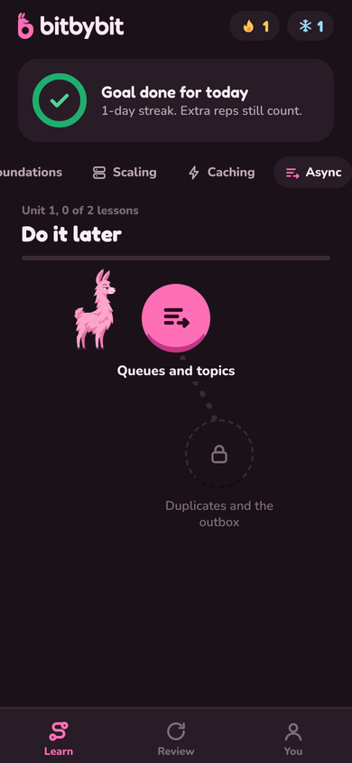
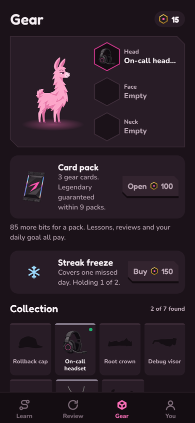
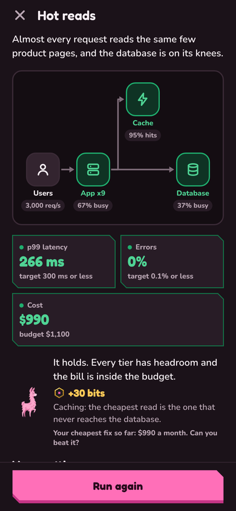
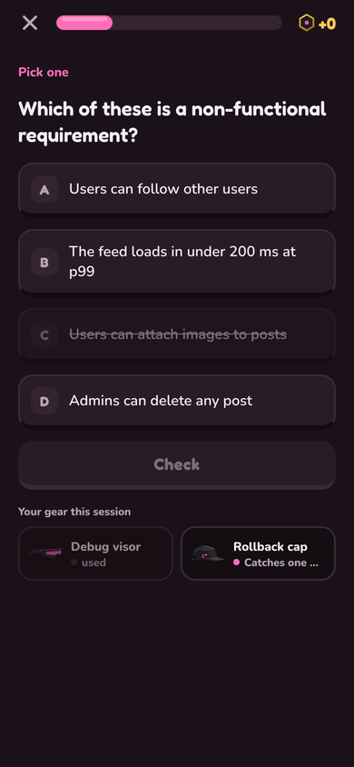
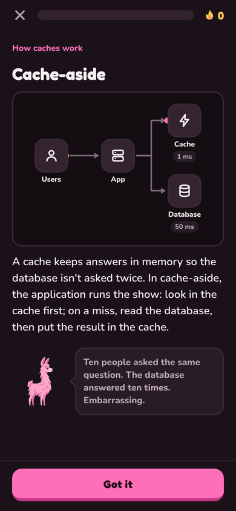
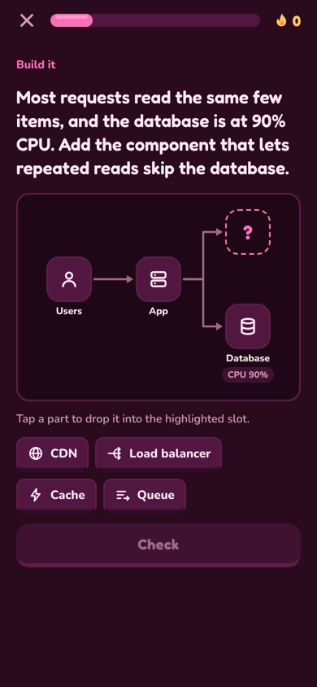
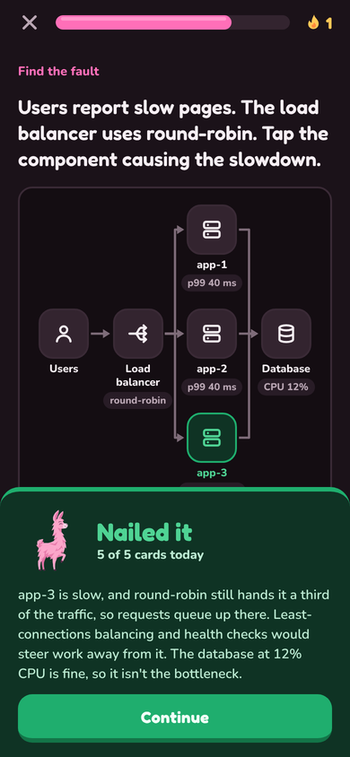
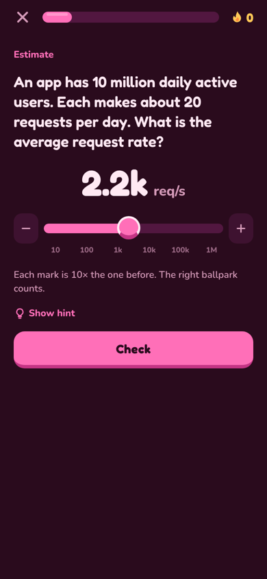

<p align="center">
  <picture>
    <source media="(prefers-color-scheme: dark)" srcset="docs/logo-dark-mode.png" />
    
  </picture>
</p>

**System design, one bit at a time.** Duolingo-style daily practice for system design: five-minute drills, spaced repetition so you actually remember them, a daily streak, and a nudge when the streak is at risk.

<p align="center">
  
  
  
  
  
  
  
  
</p>

## Features

- **Choose what to learn:** system design is split into tracks (Foundations, Scaling, Storage, Caching, Async, Consistency, with APIs and networking next). Pick any, switch any time
- **Lessons that teach, then test:** each lesson alternates a short teaching screen with a drill on that exact idea, laid out as a path you unlock lesson by lesson
- **Seven exercise types:** build it (drop components into an architecture diagram), find the fault (tap the failing part), match up, estimate on a log-scale slider, put in order, work out a number, and multiple choice
- **Live diagrams:** architectures are drawn from data, with request dots flowing along the wires on teaching screens
- **FSRS spaced repetition** in a separate review queue, so each card you've learned comes back right before you'd forget it
- **Daily streak** in your local timezone, with streak freezes
- **A track is a system you bring online:** lessons are nodes joined by wires, with requests flowing through the ones you've finished, and the streak is shown as a 14-day uptime bar like a status page
- **A simulator:** each level hands you a system failing under load. Add servers, a cache, replicas or a queue, run it, and read p99, errors, queue lag and cost. A new incident arrives every day
- **Bits, packs and gear:** bits earned by learning open card packs of gear for the llama, and every piece is a perk that changes how a lesson plays
- **Streak reminders** as local notifications (work in Expo Go) or server push via a backend worker
- **Sound:** effects for taps, answers and finished lessons, a meme clip on wrong answers (meme mode) and background music, each with its own switch on the You tab

- **Mobile app:** React Native + Expo SDK 58 (TypeScript, Expo Router), one codebase for iOS and Android
- **Backend:** FastAPI + SQLAlchemy (SQLite for dev, Postgres in Docker), FSRS scheduling, a reminder worker that sends push through Expo's push service

```
 ┌──────────── phone ─────────────┐          ┌──────────── backend ────────────┐
 │ Expo app                       │  HTTPS   │ FastAPI                          │
 │  lessons, streak UI            │ ───────▶ │  /tracks /lessons /review        │
 │  local reminders (Expo Go)     │          │  FSRS scheduler, streak rules    │
 │  push token (dev/store build)  │          │          │                       │
 └────────────────────────────────┘          │          ▼                       │
            ▲                                │ Postgres / SQLite                │
            │ APNs / FCM                     │          ▲                       │
   ┌────────┴─────────┐   POST /push/send    │          │                       │
   │ Expo push service│ ◀─────────────────── │ reminder worker (every 60s)      │
   └──────────────────┘                      └──────────────────────────────────┘
```

## Quick start

**One command (recommended):**

```bash
./dev.sh
```

That's it. It sets up the Python env and npm packages on first run, logs you in to Expo if needed, starts the backend, opens a Cloudflare tunnel to it, waits until it's reachable, and starts Expo with the right backend URL. Install **Expo Go** on your phone (log in with the same Expo account) and scan the QR code. Ctrl+C stops everything; logs are in `.dev/`.

It works on any network, including WSL and campus Wi-Fi, because both the app and the backend go through tunnels. One-time requirements: Node 22.13+, Python 3.11+ and [cloudflared](https://developers.cloudflare.com/cloudflare-one/connections/connect-networks/downloads/) (the script prints the install command if it's missing).

If your phone and computer share a network (and you're not on WSL), `./dev.sh --lan` skips the tunnels and starts faster.

### Manual setup

Your phone and laptop must be on the same Wi-Fi (see [Campus Wi-Fi](#campus-wi-fi-or-no-shared-network) if not).

**1. Backend**

```bash
cd backend
python3 -m venv .venv && source .venv/bin/activate
pip install -r requirements-dev.txt
uvicorn app.main:app --host 0.0.0.0 --port 8000 --reload
```

`--host 0.0.0.0` matters: it lets your phone reach the API over the LAN. Tables and the card content are created on startup. API docs: http://localhost:8000/docs

For server push reminders, run the worker in a second terminal: `python -m app.worker`.

**2. App**

```bash
cd mobile
npm install
npx expo start
```

Install **Expo Go** on your phone and scan the QR code. The app finds the backend automatically: it uses the IP your phone loaded the app from, on port 8000. To point it somewhere else, set `EXPO_PUBLIC_API_URL=http://<host>:8000` before `npx expo start`.

> Expo Go supports one SDK version at a time. If Expo Go says the project is incompatible, update Expo Go from the store. On Android, `npx expo start` can install the right version for you.

**Tests**

```bash
cd backend && pytest            # 83 tests: course rules, every grader, a full-course playthrough, streaks, DST, grading, bits, packs and perks, the simulator, reminders, push, API flows
cd mobile && npm run typecheck
```

## Notifications: what works where

| | Expo Go (iPhone or Android) | iOS Simulator dev build (Mac) | Android dev build | iPhone dev/TestFlight build |
|---|---|---|---|---|
| Lessons, FSRS, streaks | ✅ | ✅ | ✅ | ✅ |
| Local streak reminders | ✅ | ✅ | ✅ | ✅ |
| Server push | ❌ (removed from Expo Go in SDK 53) | Simulated with `simctl push` | ✅ free (Firebase project) | ✅ needs $99 Apple Developer account |

**How reminders work.** By default the phone schedules its own reminders: one per day for the next 7 days at your reminder time. Today's is skipped once you've met your goal. They're rescheduled every time the app opens or you finish a lesson. When the app registers a push token (only possible outside Expo Go), the backend worker takes over and local reminders are cancelled, so you never get both.

**Test local reminders (any phone, Expo Go):** You tab → *Send test reminder in 5s*, then lock the phone.

**Test push handling on the iOS Simulator (Mac, no Apple account):**

```bash
cd mobile
npx expo install expo-dev-client
npx expo run:ios                     # builds and launches in the Simulator
xcrun simctl push booted com.farbutnear.bitbybit push-test/payload.apns
```

**Test real server push end to end on Android (free):**

1. `npm i -g eas-cli && eas login && eas init` (adds your EAS `projectId` to app.json).
2. Create a Firebase project, add an Android app with package `com.farbutnear.bitbybit`, and upload its FCM V1 service account key with `eas credentials` ([Expo guide](https://docs.expo.dev/push-notifications/fcm-credentials/)).
3. `npx expo install expo-dev-client && eas build --profile development --platform android`, then install the APK.
4. In the app: You tab → *Enable server push* → *Send test server push*.
5. With `python -m app.worker` running, reminders now come from the server. To trigger the worker without waiting: `curl -X POST localhost:8000/debug/run-reminders`.

iPhone server push is the same flow with `--platform ios`. It needs an Apple Developer account for the push entitlement.

## Campus Wi-Fi or no shared network

Many university networks block devices from talking to each other. Then:

- **App code:** `npx expo start --tunnel`
- **Backend:** your phone can't reach `http://<laptop-ip>:8000`. Deploy the backend (Render, Railway and Fly.io all run the included Dockerfile) and start the app with `EXPO_PUBLIC_API_URL=https://your-backend.example npx expo start --tunnel`. Use HTTPS for anything outside your LAN.

## Mascot art

The llama lives in `mobile/assets/mascot/` as three images: `idle.png`, `happy.png` (right answer) and `sad.png` (wrong answer), each a 512×512 transparent PNG with the llama standing on the same baseline. Replace the files and the app picks them up everywhere: onboarding, home, the result panel and the lesson-complete screen.

Brand assets in `mobile/assets/`: `icon.png` (app icon, single "b" mark), `android-icon-foreground.png` / `android-icon-monochrome.png` (Android adaptive and themed icons), `splash-icon.png` (full logo, used by the `expo-splash-screen` plugin), `logo-light.png`, `wordmark-light.png` and `mark-b.png` (in-app branding) and `notification-icon.png`. Icon and splash changes show up in development and store builds, not in Expo Go.

## Sound

Sound lives in `mobile/assets/sounds/` and is played with `expo-audio`, which Expo Go includes. The effects, the default meme clip (`memes/womp.wav`) and the music loop are synthesised by `tools/make_sounds.py` (`pip install numpy scipy`), so they are original and safe to ship.

To add your own, drop audio files (`.mp3`, `.wav`, `.m4a`, `.aac`) into a folder and restart `./dev.sh`. No code changes:

- `mobile/assets/sounds/memes/`: with meme mode on, a wrong answer plays one of these at random instead of the plain sound
- `mobile/assets/sounds/music/`: any file here replaces the built-in loop; one track is picked per app start and looped

Sound follows the phone's silent switch and mixes with whatever else is playing. Effects, meme mode and music each have a switch on the You tab. Only add clips you have the right to redistribute before a store release.

## Design notes

**Spaced repetition (FSRS).** Each user×card pair stores FSRS state (stability, difficulty, due). Answers are auto-graded, so a wrong answer is `Again` and a right one is `Good`. FSRS's own learning steps are off: short-term repetition happens inside the lesson instead. A missed card is re-asked at the end, Duolingo style, and that retry counts toward the daily goal but doesn't touch the schedule.

**Learning and reviewing are separate.** New material only arrives through lessons: authored sequences of teaching screens and cards (`track → unit → lesson → step`). Within a track, lessons unlock in order and finished ones can be replayed; tracks themselves are never locked. Answering a card in a lesson puts it into FSRS, and the review queue (`GET /users/{id}/review`) serves whatever is due across every track. With nothing due, practice mode offers the cards due soonest, so the daily goal is always reachable. Lessons and reviews both count toward the goal.

**Streaks.** A day counts when you hit your daily goal on your *local* calendar date. Streak state is only written when a goal is met; "is it still alive / at risk" is computed when read. That means there's no midnight job running across every timezone. You get one freeze to start and earn one per 7-day streak (max 2); a freeze covers one missed day. Moving to a timezone behind your old one never double-counts or breaks the streak.

**Reminder worker.** Users with a push token have a `next_reminder_at` (UTC, indexed), computed from their local reminder time with `zoneinfo`, so it's DST-correct. Each tick claims due users with a conditional `UPDATE ... WHERE next_reminder_at = <old>`, so several workers can run without double-sending. The claim happens *before* the send, which makes reminders at-most-once: a missed nudge is better than a duplicate. Users who already met today's goal are skipped. Tokens Expo reports as `DeviceNotRegistered` are deleted.

**Bits, packs and gear.** Bits are earned by learning and can't be bought: 5 for a new or due card answered right first try, 25 for the daily goal, 20 for finishing a lesson the first time, 50 for each full week of streak. Replays and practising ahead pay almost nothing, so grinding one easy card is pointless. 100 bits open a pack of three gear cards. The odds (60% common, 35% rare, 5% legendary per card) are returned by `GET /users/{id}/loot` so the app can show them, a legendary is guaranteed at least every 10th pack, and duplicates pay bits back. Bits also buy streak freezes.

Gear goes in three slots (head, face, neck) and each piece changes how a session plays. See `backend/app/loot.py` for the catalogue:

| Gear | Slot | Perk |
|---|---|---|
| Rollback cap | Head | The first wrong answer of a session is caught before it counts: nothing is revealed and you answer again |
| On-call headset | Head | From the third right answer in a row, each one pays 3 extra bits |
| Root crown | Head | Face gear gets a second charge |
| Debug visor | Face | Strikes one wrong option off a multiple-choice card, once per session |
| Tracer lens | Face | Rules out one healthy component on a find-the-fault card, once per session |
| Replica tags | Neck | The streak can hold one more freeze |
| Block chain | Neck | 25% more bits |

No perk answers a card for you, and the server decides what to strike, so the answer still never reaches the app. A card answered with help is rated `Hard` instead of `Good` in FSRS and pays 2 bits instead of 5, so it comes back sooner. Charges are counted per play session (`session.id` in the lesson and review payloads; send it back as `session_id` with each answer).

**Simulator.** `backend/app/sim.py` is a small deterministic queueing model, so the same settings always give the same numbers and each result can be explained in a sentence. Every tier is an M/M/1 queue: utilisation is load over capacity, mean latency is service time / (1 - utilisation), and p99 is ln(100) times the mean of the slowest path that carries at least 1% of requests (so with a cache, the tail is the misses). A tier at or over 100% drops the excess. Replicas share reads but each one applies every write; a queue lets workers feed a write burst to the database at their own pace, and reports how far behind it gets. Levels live in `content/sim.json` as a workload, priced knobs and goals. Tests brute-force every level to prove it starts broken and can be fixed inside its budget. The daily incident is one of the levels with traffic scaled by a factor derived from the date, and a budget set 15% above its cheapest fix.

**Grading happens server-side.** Lesson and review payloads never include answers. Numeric answers are graded by ratio (`tolerance: 1.5` means within 1.5× either way), which suits back-of-envelope estimates.

## Project layout

```
backend/
  app/
    main.py          HTTP routes
    course.py        tracks, the lesson path, lesson contents and completion
    service.py       answering cards, the review queue, reminder tick
    srs.py           FSRS wrapper + answer grading
    loot.py          bits, card packs, gear and perks
    sim.py           the simulator's queueing model, levels and daily incident
    streaks.py       streak rules (pure functions)
    reminders.py     next reminder time (DST-aware), message text
    push.py          Expo push client (batched, error mapping)
    worker.py        reminder loop
    content/course.json  tracks, units, lessons and teaching screens
    content/cards.json   the cards lessons refer to
    content/sim.json     simulator levels
  tests/
mobile/
  src/app/           (tabs)/ Learn, Review, Gear and You; plus onboarding, lesson, sim, lab, pack and tracks
  src/components/    Diagram, system map, status board, gear cards, track picker, teach screen, result panel, UI kit
  src/components/exercises/   one component per card kind
  src/lib/           api client, notifications, sound, motion, user context, theme
  assets/sounds/     effects, plus drop-in memes/ and music/ folders
tools/make_sounds.py synthesises the sound effects and the music loop
docker-compose.yml   Postgres + API + worker
```

## Adding content

Content lives in two files in `backend/app/content/`, upserted when the API starts.

`course.json` is the structure. A lesson is a list of steps, each either a teaching screen or a reference to a card:

```jsonc
{ "id": "caching-u1-l1", "title": "How caches work", "steps": [
    { "teach": { "title": "Cache-aside", "body": "Up to 60 words, one idea.", "llama": "Optional one-liner." } },
    { "card": "caching-cache-aside" }
] }
```

A track with no units is listed in the app as "Coming next". A teaching screen can also carry a `diagram`.

`cards.json` holds the cards, each with the `track` it belongs to. Seven kinds:

```jsonc
{ "kind": "mcq",     "data": { "options": ["…"], "answer": 1, "diagram": { /* optional */ } } }
{ "kind": "order",   "data": { "items": ["first", "second", "third"] } }   // items in the correct order
{ "kind": "numeric", "data": { "answer": 12, "tolerance": 1.0, "unit": "servers", "hint": "optional" } }
{ "kind": "slider",  "data": { "min": 10, "max": 1000000, "answer": 2315, "tolerance": 1.5, "unit": "req/s" } }
{ "kind": "spot",    "data": { "diagram": { /* … */ }, "answer": "app3" } }              // id of the faulty node
{ "kind": "build",   "data": { "diagram": { /* with slot nodes */ }, "slots": { "s1": "cache" }, "bank": ["cache", "queue", "cdn"] } }
{ "kind": "match",   "data": { "pairs": [["Duplicate deliveries", "Idempotent consumer"], ["…", "…"]] } }
```

`tolerance` is a ratio: 1.5 means within 1.5× either way. A diagram is nodes on a grid up to four columns wide, edges that run left to right, and optional animated flows:

```jsonc
{ "nodes": [ { "id": "app", "kind": "app", "label": "App", "x": 1, "y": 0.5, "note": "p99 40 ms" },
             { "id": "s1", "kind": "slot", "x": 2, "y": 0 } ],
  "edges": [["app", "s1"]],
  "flows": [ { "path": ["users", "app"], "speed": "fast" } ] }
```

Node kinds: `client`, `lb`, `app`, `cache`, `db`, `replica`, `queue`, `worker`, `cdn`, `box`, and `slot` (an empty place for a build card; give it no label).

`pytest` checks that every card's answer grades as correct against itself, that diagrams are well formed, that every card is taught in exactly one lesson on its own track, and that the whole course can be played start to finish.

## Prototype shortcuts to fix before shipping

- **No auth:** the user id in local storage is the only credential. Add sign-in (e.g. Sign in with Apple/Google) and authorize every `/users/{id}` route.
- **Debug routes:** `/debug/*` is on by default. Set `BITBYBIT_ENABLE_DEBUG_ROUTES=false` in production.
- **Schema:** no migrations. When `SCHEMA_VERSION` in `db.py` changes, the database is rebuilt on startup and all users and progress are lost (the app then sends you back through onboarding). Set `BITBYBIT_RESET_DB_ON_SCHEMA_CHANGE=false` and add Alembic before there is data worth keeping.
- **Push receipts:** the worker reads Expo push *tickets* but doesn't poll *receipts*, where some delivery errors appear.
- **Content:** 28 cards in 12 lessons across 6 tracks is enough to feel the loop, not a course. Only four teaching screens have diagrams so far.
