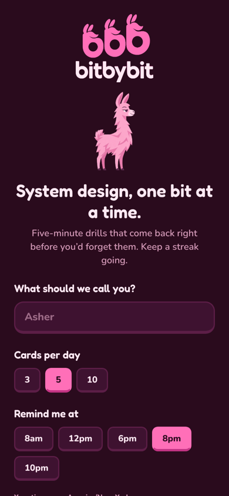
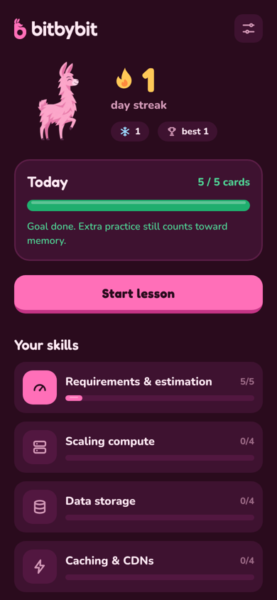
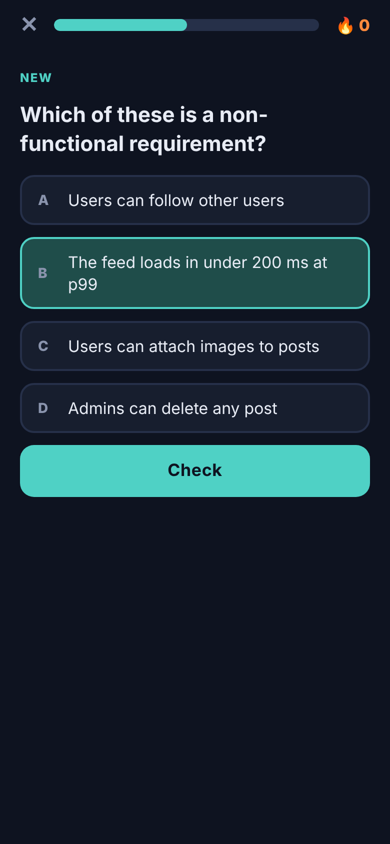
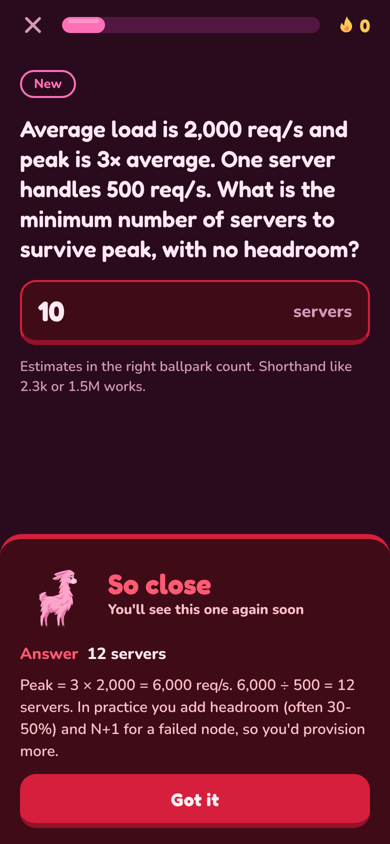
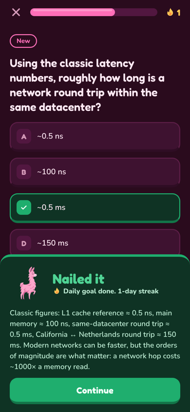

<p align="center">
  <picture>
    <source media="(prefers-color-scheme: dark)" srcset="docs/logo-dark-mode.png" />
    
  </picture>
</p>

**System design, one bit at a time.** Duolingo-style daily practice for system design: five-minute drills, spaced repetition so you actually remember them, a daily streak, and a nudge when the streak is at risk.

<p align="center">
  
  
  
  
  
</p>

## Features

- **Bite-sized lessons** with three drill types: multiple choice (some with architecture diagrams), put-the-steps-in-order, and back-of-envelope estimates graded within a tolerance
- **FSRS spaced repetition**, so each card comes back right before you'd forget it
- **Daily streak** in your local timezone, with streak freezes
- **Streak reminders** as local notifications (work in Expo Go) or server push via a backend worker
- **Skill map** showing progress across estimation, compute, storage, caching, async processing and consistency

- **Mobile app:** React Native + Expo SDK 58 (TypeScript, Expo Router), one codebase for iOS and Android
- **Backend:** FastAPI + SQLAlchemy (SQLite for dev, Postgres in Docker), FSRS scheduling, a reminder worker that sends push through Expo's push service

```
 ┌──────────── phone ─────────────┐          ┌──────────── backend ────────────┐
 │ Expo app                       │  HTTPS   │ FastAPI                          │
 │  lessons, streak UI            │ ───────▶ │  /users /session /reviews        │
 │  local reminders (Expo Go)     │          │  FSRS scheduler, streak rules    │
 │  push token (dev/store build)  │          │          │                       │
 └────────────────────────────────┘          │          ▼                       │
            ▲                                │ Postgres / SQLite                │
            │ APNs / FCM                     │          ▲                       │
   ┌────────┴─────────┐   POST /push/send    │          │                       │
   │ Expo push service│ ◀─────────────────── │ reminder worker (every 60s)      │
   └──────────────────┘                      └──────────────────────────────────┘
```

## Quick start

**One command (recommended):**

```bash
./dev.sh
```

That's it. It sets up the Python env and npm packages on first run, logs you in to Expo if needed, starts the backend, opens a Cloudflare tunnel to it, waits until it's reachable, and starts Expo with the right backend URL. Install **Expo Go** on your phone (log in with the same Expo account) and scan the QR code. Ctrl+C stops everything; logs are in `.dev/`.

It works on any network, including WSL and campus Wi-Fi, because both the app and the backend go through tunnels. One-time requirements: Node 22.13+, Python 3.11+ and [cloudflared](https://developers.cloudflare.com/cloudflare-one/connections/connect-networks/downloads/) (the script prints the install command if it's missing).

If your phone and computer share a network (and you're not on WSL), `./dev.sh --lan` skips the tunnels and starts faster.

### Manual setup

Your phone and laptop must be on the same Wi-Fi (see [Campus Wi-Fi](#campus-wi-fi-or-no-shared-network) if not).

**1. Backend**

```bash
cd backend
python3 -m venv .venv && source .venv/bin/activate
pip install -r requirements-dev.txt
uvicorn app.main:app --host 0.0.0.0 --port 8000 --reload
```

`--host 0.0.0.0` matters: it lets your phone reach the API over the LAN. Tables and the card content are created on startup. API docs: http://localhost:8000/docs

For server push reminders, run the worker in a second terminal: `python -m app.worker`.

**2. App**

```bash
cd mobile
npm install
npx expo start
```

Install **Expo Go** on your phone and scan the QR code. The app finds the backend automatically: it uses the IP your phone loaded the app from, on port 8000. To point it somewhere else, set `EXPO_PUBLIC_API_URL=http://<host>:8000` before `npx expo start`.

> Expo Go supports one SDK version at a time. If Expo Go says the project is incompatible, update Expo Go from the store. On Android, `npx expo start` can install the right version for you.

**Tests**

```bash
cd backend && pytest            # 33 tests: streaks, DST, grading, reminders, push batching, API flows
cd mobile && npm run typecheck
```

## Notifications: what works where

| | Expo Go (iPhone or Android) | iOS Simulator dev build (Mac) | Android dev build | iPhone dev/TestFlight build |
|---|---|---|---|---|
| Lessons, FSRS, streaks | ✅ | ✅ | ✅ | ✅ |
| Local streak reminders | ✅ | ✅ | ✅ | ✅ |
| Server push | ❌ (removed from Expo Go in SDK 53) | Simulated with `simctl push` | ✅ free (Firebase project) | ✅ needs $99 Apple Developer account |

**How reminders work.** By default the phone schedules its own reminders: one per day for the next 7 days at your reminder time. Today's is skipped once you've met your goal. They're rescheduled every time the app opens or you finish a lesson. When the app registers a push token (only possible outside Expo Go), the backend worker takes over and local reminders are cancelled, so you never get both.

**Test local reminders (any phone, Expo Go):** Settings → *Send test reminder in 5s*, then lock the phone.

**Test push handling on the iOS Simulator (Mac, no Apple account):**

```bash
cd mobile
npx expo install expo-dev-client
npx expo run:ios                     # builds and launches in the Simulator
xcrun simctl push booted com.farbutnear.bitbybit push-test/payload.apns
```

**Test real server push end to end on Android (free):**

1. `npm i -g eas-cli && eas login && eas init` (adds your EAS `projectId` to app.json).
2. Create a Firebase project, add an Android app with package `com.farbutnear.bitbybit`, and upload its FCM V1 service account key with `eas credentials` ([Expo guide](https://docs.expo.dev/push-notifications/fcm-credentials/)).
3. `npx expo install expo-dev-client && eas build --profile development --platform android`, then install the APK.
4. In the app: Settings → *Enable server push* → *Send test server push*.
5. With `python -m app.worker` running, reminders now come from the server. To trigger the worker without waiting: `curl -X POST localhost:8000/debug/run-reminders`.

iPhone server push is the same flow with `--platform ios`. It needs an Apple Developer account for the push entitlement.

## Campus Wi-Fi or no shared network

Many university networks block devices from talking to each other. Then:

- **App code:** `npx expo start --tunnel`
- **Backend:** your phone can't reach `http://<laptop-ip>:8000`. Deploy the backend (Render, Railway and Fly.io all run the included Dockerfile) and start the app with `EXPO_PUBLIC_API_URL=https://your-backend.example npx expo start --tunnel`. Use HTTPS for anything outside your LAN.

## Mascot art

The llama lives in `mobile/assets/mascot/` as three images: `idle.png`, `happy.png` (right answer) and `sad.png` (wrong answer), each a 512×512 transparent PNG with the llama standing on the same baseline. Replace the files and the app picks them up everywhere: onboarding, home, the result panel and the lesson-complete screen.

Brand assets in `mobile/assets/`: `icon.png` (app icon, single "b" mark), `android-icon-foreground.png` / `android-icon-monochrome.png` (Android adaptive and themed icons), `splash-icon.png` (full logo, used by the `expo-splash-screen` plugin), `logo-light.png`, `wordmark-light.png` and `mark-b.png` (in-app branding) and `notification-icon.png`. Icon and splash changes show up in development and store builds, not in Expo Go.

## Design notes

**Spaced repetition (FSRS).** Each user×card pair stores FSRS state (stability, difficulty, due). Answers are auto-graded, so a wrong answer is `Again` and a right one is `Good`. FSRS's own learning steps are off: short-term repetition happens inside the lesson instead. A missed card is re-asked at the end, Duolingo style, and that retry counts toward the daily goal but doesn't touch the schedule. A lesson is: due reviews → new cards (max 5/day, in curriculum order) → reviews ahead of schedule as filler, so there's always something to practice.

**Streaks.** A day counts when you hit your daily goal on your *local* calendar date. Streak state is only written when a goal is met; "is it still alive / at risk" is computed when read. That means there's no midnight job running across every timezone. You get one freeze to start and earn one per 7-day streak (max 2); a freeze covers one missed day. Moving to a timezone behind your old one never double-counts or breaks the streak.

**Reminder worker.** Users with a push token have a `next_reminder_at` (UTC, indexed), computed from their local reminder time with `zoneinfo`, so it's DST-correct. Each tick claims due users with a conditional `UPDATE ... WHERE next_reminder_at = <old>`, so several workers can run without double-sending. The claim happens *before* the send, which makes reminders at-most-once: a missed nudge is better than a duplicate. Users who already met today's goal are skipped. Tokens Expo reports as `DeviceNotRegistered` are deleted.

**Grading happens server-side.** The session payload never includes answers. Numeric answers are graded by ratio (`tolerance: 1.5` means within 1.5× either way), which suits back-of-envelope estimates.

## Project layout

```
backend/
  app/
    main.py          HTTP routes
    service.py       lesson building, reviews, skill progress, reminder tick
    srs.py           FSRS wrapper + answer grading
    streaks.py       streak rules (pure functions)
    reminders.py     next reminder time (DST-aware), message text
    push.py          Expo push client (batched, error mapping)
    worker.py        reminder loop
    content/cards.json   skills and cards
  tests/
mobile/
  src/app/           screens: index (home), onboarding, lesson, settings
  src/components/    question cards (mcq / order / numeric), UI kit
  src/lib/           api client, notifications, user context, theme
docker-compose.yml   Postgres + API + worker
```

## Adding content

Edit `backend/app/content/cards.json` and restart the API; content is upserted on startup. Three card kinds:

```jsonc
{ "kind": "mcq",     "data": { "options": ["…"], "answer": 1, "diagram": "optional ASCII" } }
{ "kind": "order",   "data": { "items": ["first", "second", "third"] } }   // items in the correct order
{ "kind": "numeric", "data": { "answer": 2315, "tolerance": 1.5, "unit": "req/s", "hint": "optional" } }
```

`pytest` checks that every card's answer grades as correct against itself.

## Prototype shortcuts to fix before shipping

- **No auth:** the user id in local storage is the only credential. Add sign-in (e.g. Sign in with Apple/Google) and authorize every `/users/{id}` route.
- **Debug routes:** `/debug/*` is on by default. Set `BITBYBIT_ENABLE_DEBUG_ROUTES=false` in production.
- **Schema:** `create_all` on startup instead of Alembic migrations.
- **Push receipts:** the worker reads Expo push *tickets* but doesn't poll *receipts*, where some delivery errors appear.
- **Content:** 26 cards across 6 skills is enough to feel the loop, not a course.
